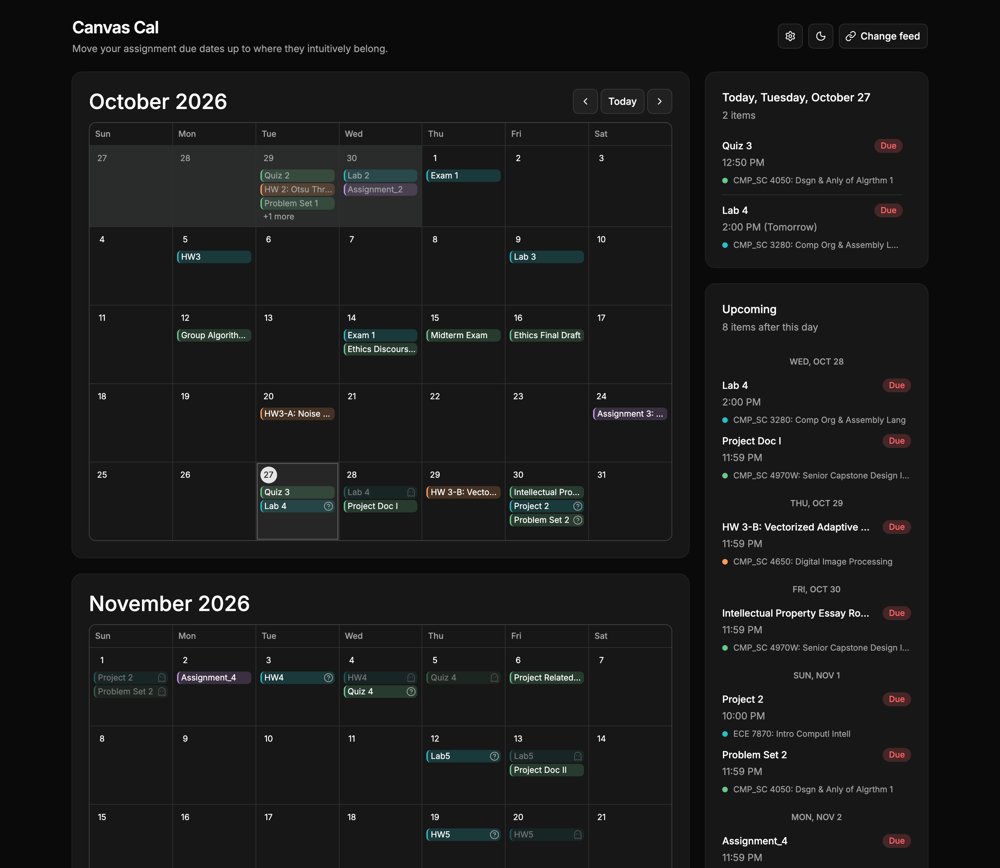
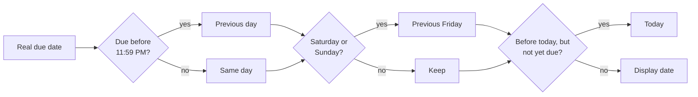

<div align="center">


# Canvas Cal

**Move your assignment due dates up to where they intuitively belong.**

A calendar for your Canvas LMS feed that shows each assignment on the day you actually need to finish it, not the day it's technically due.


**[Open Canvas Cal](https://cal.clayk.cc)** · **[See it with an example feed](https://cal.clayk.cc/?canvasFeed=https%3A%2F%2Fumsystem.instructure.com%2Ffeeds%2Fcalendars%2Fuser_epYWGJ78l90wiUiiFm9GRi0lLlTFK2Fmf61IJ2QY.ics)**



</div>

---

## Why?

Canvas puts an assignment on the calendar day it's due. That's technically right, but it's not how a week actually goes:

- A quiz due **Tuesday at 9:00 AM** really has to be done **Monday**.
- A homework due **Sunday at 11:59 PM** is, for most people, **Friday's** problem.
- An assignment whose "do it" day has already passed still needs to be on your radar **today**.

Canvas Cal reads your private Canvas calendar feed and moves each assignment to the day you should be working on it. Course events like lectures, exams, and office hours stay on their real dates.

## Features

- 📅 **Two-month view.** See the current month and the next one together. Each course gets its own consistent color.
- 🪄 **Smart display dates.** Assignments move earlier according to clear, configurable rules (see [below](#how-display-dates-work)).
- 👻 **Ghost due dates.** A faded copy stays on the real due date so you never lose track of the deadline. You can hide it.
- 💬 **Hover explanations.** Hover a moved assignment to see exactly why it moved, along with its real due date and time.
- 🗓️ **Day agenda and Upcoming list.** Pick a day to see what's on it. On today, assignments pulled forward show their real due day, such as "(Tomorrow)" or "(Thursday)".
- 🔗 **Subscribable iCal feed.** Add the adjusted calendar to Google Calendar, Apple Calendar, or Outlook, with the same moved dates.
- 🔖 **Bookmarkable.** The page URL carries your feed, so a bookmark reopens your calendar right away.
- 🌗 **Light and dark themes**, an accessible UI built on [shadcn-svelte](https://shadcn-svelte.com), and a layout that works on mobile.
- 🐞 **Debug Mode.** Pretend any date is "today" to see how the calendar will look then.

## How display dates work

Course events always stay on their real dates, weekends included. **Assignments** get a *display date*, worked out in four steps:

| # | Rule | Example |
|---|------|---------|
| 1 | **Early due time.** If the assignment is due before 11:59 PM (and isn't all-day), show it the **previous day**. 11:59 PM stays on the due date. | Due Wed 9:00 AM → shown **Tue** |
| 2 | **No weekends.** If the date from step 1 is a Saturday or Sunday, show it on the **previous Friday**. | Due Sun 11:59 PM → shown **Fri**<br>Due Mon 8:00 AM → Sun → shown **Fri** |
| 3 | **Catch up to today.** If the display date is already in the past but the real due date is today or later, show it on **today**. It stays there until it's due. | Today is Sat, due Mon 9:00 AM → Sun → Fri, already past → shown **Sat** |
| 4 | **Past due.** Once the real due date has passed, show the assignment on its **real date**. | Due last Wed → shown last **Wed** |

Steps 1 and 2 each have a switch in the ⚙️ settings menu. When a move changes an assignment's day, its hover card says which rule moved it.



## Getting started (as a user)

1. In Canvas, open **Calendar** and click **Calendar Feed** in the sidebar.
2. Copy the link. It looks like `https://<school>.instructure.com/feeds/calendars/user_….ics`.
3. Open Canvas Cal, paste the link into **Add your Canvas calendar**, and press **Load calendar**.
4. Optional: **bookmark** the page, or copy the **iCal Feed** link into your calendar app.

### Example feed

If you just want to see how the app looks, paste this feed into the dialog or [open it directly](https://cal.clayk.cc/?canvasFeed=https%3A%2F%2Fumsystem.instructure.com%2Ffeeds%2Fcalendars%2Fuser_epYWGJ78l90wiUiiFm9GRi0lLlTFK2Fmf61IJ2QY.ics):

```
https://umsystem.instructure.com/feeds/calendars/user_epYWGJ78l90wiUiiFm9GRi0lLlTFK2Fmf61IJ2QY.ics
```

> [!WARNING]
> Your Canvas feed link is a secret. Anyone who has it can read your calendar. The bookmark link and the iCal link both contain it, so keep them private.

### Settings

All settings live in the ⚙️ menu and are saved in your browser's `localStorage` under `canvas-calendar-display`.

| Setting | Default | What it does |
|---|---|---|
| Due before 11:59 PM | On | Show assignments due earlier than 11:59 PM on the previous day. |
| Keep off weekends | On | Move weekend display dates to the previous Friday. |
| Hide due dates | Off | Remove the faded "ghost" copy on the real due date. |
| Debug Mode | Off | Choose which date the app treats as today. This affects display moves and the Yesterday, Today, and Tomorrow labels. |

## iCal subscription endpoint

`GET /calendar.ics` returns the adjusted calendar as `text/calendar`. The copy button in the app builds this URL for you.

| Query param | Required | Description |
|---|---|---|
| `canvasFeed` | ✅ | Your Canvas `.ics` feed URL. |
| `tz` | | IANA time zone, such as `America/Chicago`. Invalid or missing values fall back to `UTC`. |
| `early` | | Set to `0` to turn off the "due before 11:59 PM" move. |
| `weekend` | | Set to `0` to turn off the "keep off weekends" move. |
| `today` | | A `YYYY-MM-DD` date to treat as today. The app sets it from Debug Mode. |

Moved timed assignments keep their clock time on the new day. When an assignment has moved, the event description adds a line with its real due date: `Actual due date: YYYY-MM-DD`.

## Privacy and security

Canvas Cal has **no database and no accounts**. The server fetches your feed when a request comes in, turns it into the calendar, and keeps nothing. Responses from `/calendar.ics` are sent with `Cache-Control: no-store`.

The server fetches a URL that the user provides, so `src/lib/canvas/feed-url.ts` and `fetch-feed.ts` lock that fetch down to prevent SSRF:

- **HTTPS only**, on the default port, with no embedded username or password.
- The path must match **`/feeds/calendars/<id>.ics`**, the Canvas feed format.
- `localhost`, `*.local`, `*.internal`, and **private, loopback, link-local, CGNAT, multicast, and documentation IP ranges** (IPv4 and IPv6, including IPv4-mapped) are rejected. This applies to the literal host **and to every address it resolves to in DNS**.
- Redirects are followed by hand, **at most 3 hops**, and each hop is checked again.
- **10 second timeout** and a **2 MB** limit on response size.

## Tech stack

| Layer | Tools |
|---|---|
| Framework | [SvelteKit 2](https://svelte.dev/docs/kit) with [Svelte 5](https://svelte.dev) runes and `adapter-auto` |
| UI | [shadcn-svelte](https://shadcn-svelte.com), [bits-ui](https://bits-ui.com), [Lucide](https://lucide.dev) icons, Inter Variable |
| Styling | [Tailwind CSS 4](https://tailwindcss.com), `tw-animate-css`, `mode-watcher` for theming |
| Dates | [`@internationalized/date`](https://react-spectrum.adobe.com/internationalized/date/) for time-zone-aware calendar math |
| Feed parsing | [`node-ical`](https://github.com/jens-maus/node-ical) |
| Testing | [Vitest](https://vitest.dev) |

## Project structure

```
src/
├── app.html                     # HTML shell with Open Graph / Twitter meta
├── hooks.server.ts              # Fills in the origin and description placeholders in meta tags
├── lib/
│   ├── site.ts                  # Site description text
│   ├── canvas/
│   │   ├── ics.ts               # Parse Canvas .ics → FeedItem[] (course names, assignment detection)
│   │   ├── dates.ts             # Display-date rules, course colors, labels and sorting
│   │   ├── ical.ts              # Build the adjusted .ics calendar
│   │   ├── feed-url.ts          # URL validation and public-IP checks (SSRF guard)
│   │   ├── fetch-feed.ts        # Safe fetch: manual redirects, timeout, size limit
│   │   ├── canvas-feed-param.ts # The `canvasFeed` query parameter
│   │   ├── fixture.ts           # Sample feed for local development
│   │   └── *.test.ts            # Vitest unit tests
│   └── components/
│       ├── month-calendar.svelte    # Month grid with course-colored chips
│       ├── display-settings.svelte  # ⚙️ menu, saved settings, Debug Mode
│       ├── event-hover.svelte       # Hover card with real due date and move reasons
│       ├── ghost-hint.svelte        # Faded copy on the real due date
│       ├── move-hint.svelte         # Explains why an item moved
│       ├── theme-toggle.svelte      # Light / dark switch
│       └── ui/                      # shadcn-svelte primitives
└── routes/
    ├── +page.server.ts          # Loads and parses the feed from ?canvasFeed=
    ├── +page.svelte             # Calendar, agenda, Upcoming, Bookmark, iCal cards
    └── calendar.ics/+server.ts  # The iCal subscription endpoint
```

## Development

Requires Node.js (`engine-strict` is on, so use a current LTS release).

```sh
npm install        # install dependencies
npm run dev        # start the dev server (add -- --open to open a browser tab)
npm test           # run the Vitest suite
npm run check      # type-check with svelte-check
npm run build      # production build
npm run preview    # preview the production build
```

### Sample data

You don't need a real Canvas feed during development. Open

```
http://localhost:5173/?fixture=1
```

to load the sample calendar in `src/lib/canvas/fixture.ts`. `/calendar.ics?fixture=1` works the same way. The fixture is **available only in dev** and returns 404 in production.

### Deploying

The project uses [`@sveltejs/adapter-auto`](https://svelte.dev/docs/kit/adapter-auto), which detects Vercel, Netlify, Cloudflare, and similar hosts. The feed fetcher uses `node:dns` and `node:net`, so deploy to a **Node.js runtime**, not an edge runtime. To target a specific host, replace the adapter in `vite.config.ts`.

## Contributing

Agent and contributor notes on the display-date rules are in [`AGENTS.md`](AGENTS.md). If you change how dates move, update the tests in `src/lib/canvas/*.test.ts` and that document as well.

---

<div align="center">

© 2026 [Clayton Kruse](https://clayk.cc)

</div>
